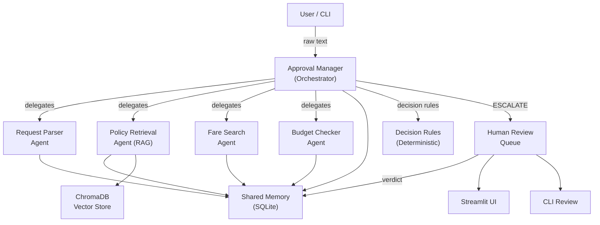

# CSE476 CA2 — Corporate Travel Policy Booking Auditor

| Field | Detail |
|-------|--------|
| **Course** | CSE476 — Multi-Agent Systems |
| **Assessment** | CA2 — Group 15, Q15 |
| **Member** | Yaswanth Kumar Mallela (Reg. No. 12315067) |
| **Outcomes** | CO3, CO4 · Bloom's L4, L5, L6 · 30 marks |

---

## Problem Statement

Automate the audit of employee travel requests against a corporate travel
policy. A multi-agent system parses requests, retrieves applicable policy
clauses via RAG, searches fares, checks budgets, and issues a deterministic
**APPROVE / MODIFY / ESCALATE** decision — with escalated requests routed to a
human reviewer in a manager-approval loop.

---

## Architecture



**Coordination pattern:** Manager-Worker delegation with Human Routing.
The Approval Manager orchestrates four specialised worker agents, each
implemented as a separate module using Semantic Kernel.

---

## Setup

### Prerequisites
- Python 3.11+
- A Google Gemini API key (free from [AI Studio](https://aistudio.google.com/apikey))

### Install

```bash
cd travel_auditor
pip install -r requirements.txt
```

### Configure .env

Open `.env` in the project root. The only **required** variable is:

| Variable | Required? | How to get it |
|----------|-----------|---------------|
| `GOOGLE_API_KEY` | **Yes** | Free at https://aistudio.google.com/apikey |
| `GEMINI_MODEL_NAME` | No (default: `gemini-2.0-flash`) | |
| `LOG_LEVEL` | No (default: `INFO`) | |
| `TODAY_DATE` | No (default: `2026-11-12`) | `YYYY-MM-DD` |
| `RATE_LIMIT_RPM` | No (default: `10`) | |
| All others | No | See `.env` comments |

Set your API key:
```
GOOGLE_API_KEY=your_key_here
```

All other variables have sensible defaults. The system will fail fast at
startup with a clear message if `GOOGLE_API_KEY` is missing.

---

## Run Commands

### Interactive Web Application (Flask Web UI & REST API)
```bash
python app.py
```
Open **http://127.0.0.1:5000** in your browser. Includes interactive Audit Request forms, 1-click Preset Cases, Human Review Queue with live verdict flowback, 10-Case Benchmark runner, Budget Ledger, and Audit Trail.

### Audit a single request (CLI)
```bash
python main.py audit "I need to fly Delhi to Mumbai on 2 Dec 2026 for a client meeting. Economy. Employee E101."
```

### Run without LLM (rule-based fallbacks)
```bash
python main.py audit --no-llm "I need to fly Delhi to Mumbai on 2 Dec 2026 for a client meeting. Economy. Employee E101."
```

### Run full evaluation (10 cases)
```bash
python main.py eval
```

### Human review queue
```bash
python main.py review list
python main.py review show REQ-XXXXXXXX
python main.py review decide REQ-XXXXXXXX --verdict approve --note "Manager approved"
```

### Streamlit review UI
```bash
streamlit run ui/review_app.py
```

### Run evaluation
```bash
python eval/run_eval.py
```

### Evaluation Benchmark Results (10/10 Cases)
| Metric | Result | Target Benchmark |
|---|---|---|
| **Decision Accuracy** | **100% (10/10)** | Ground Truth Decisions (3 APPROVE, 2 MODIFY, 5 ESCALATE) |
| **Clause Correctness** | **100% (10/10)** | Primary Clause ID Match (TP-1.1 to TP-9.1) |
| **Best Fare Accuracy** | **100% (10/10)** | Optimal Compliant Fare |
| **Average Latency** | **1.173s** | End-to-End Execution |
| **Confusion Matrix** | Perfect Diagonal | 0 False Positives / 0 False Negatives |

### Run tests
```bash
pytest -v
```

---

## Design Decisions

1. **Deterministic decisions:** The LLM is only used for (a) parsing requests,
   (b) optional re-ranking of RAG results, and (c) generating justification
   text. The APPROVE / MODIFY / ESCALATE decision is always made by the
   deterministic rule engine in `decision_rules.py`. This ensures
   reproducibility, testability, and free-tier resilience.

2. **Clause precedence:** When multiple policy violations apply, the primary
   clause follows the defined precedence order:
   `TP-6.1 > TP-1.1 > TP-7.1 > TP-9.1 > TP-4.1 > TP-2.1 > TP-2.2`.

3. **RAG per clause:** The travel policy is chunked into one document per
   clause, stored in ChromaDB with `clause_id` metadata. Multi-query retrieval
   generates 3-5 targeted queries per request for high recall.

4. **Shared memory:** All five agents read from and write to the same SQLite
   database through `MemoryStore`. The audit log captures every inter-agent
   action. No agent touches SQLite directly.

5. **Free-tier safety:** A shared async rate limiter (configurable RPM) with
   exponential backoff + jitter wraps every LLM call. Disk caching prevents
   duplicate calls. At most 3 LLM calls per request.

6. **Graceful degradation:** If the API key is invalid or quota exhausted, the
   parser falls back to regex, re-ranking is skipped, and justification uses
   templates. The decision engine works without any LLM.

---

## Assumptions

- The mock fare data covers only the eval case routes/dates.
- IATA code lookup covers a fixed set of cities.
- "International" = any endpoint not in the Indian IATA set.
- Quarter boundaries: Q1=Jan-Mar, Q2=Apr-Jun, Q3=Jul-Sep, Q4=Oct-Dec.
- Budget deduction happens immediately on APPROVE; no reconciliation workflow.

---

## Limitations

- Mock fare tool only (no real flight API).
- Single-model Gemini — no ensemble or cross-model verification.
- No authentication on the Streamlit UI.
- The regex fallback parser may misparse unusual date formats or city names.

---

## Project Structure

```
travel_auditor/
├── .env / .env.example        Config (fill API key)
├── main.py                    CLI entry point
├── config.py                  Config loader
├── llm_factory.py             Gemini service + rate limiter
├── agents/
│   ├── request_parser_agent   NL → structured request
│   ├── policy_retrieval_agent RAG over policy
│   ├── fare_search_agent      Mock fare lookup
│   ├── budget_checker_agent   Cap + budget check
│   └── approval_manager       Manager / orchestrator
├── core/
│   ├── schemas.py             Pydantic models
│   ├── memory.py              SQLite shared memory
│   ├── rag.py                 ChromaDB ingestion / retrieval
│   ├── decision_rules.py      Deterministic rule engine
│   ├── hitl.py                Human review queue
│   └── rate_limiter.py        Rate limiter + disk cache
├── tools/fare_tool.py         Mock fare search plugin
├── data/                      Policy, mock data, eval cases
├── eval/                      Evaluation runner + report
├── ui/review_app.py           Streamlit human review UI
└── tests/                     pytest suite
```
