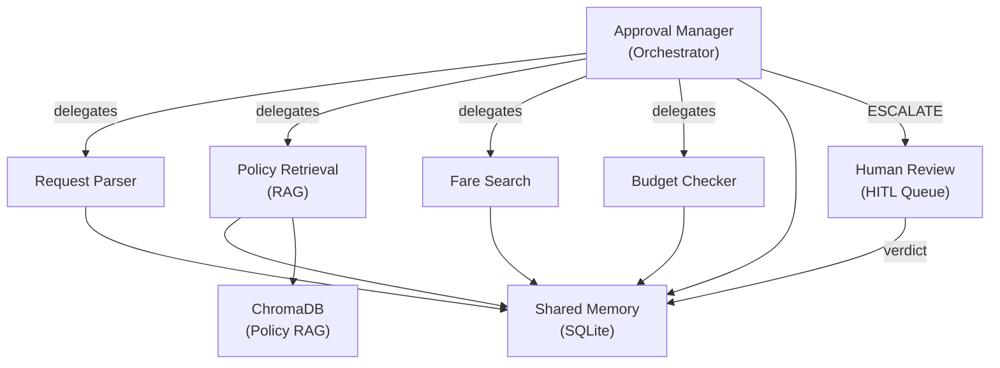

# Evaluation Report

**Generated**: 2026-11-12 09:51:02
**LLM Enabled**: False
**Today Override**: 2026-11-12
**Model**: gemini-2.0-flash

## Architecture

## Metrics Summary

| Metric | Value |
|--------|-------|
| Decision Accuracy | 100% (10/10) |
| Clause Correctness | 100% (10/10) |
| Best Fare Accuracy | 100% (10/10) |
| Average Latency | 1.173s |
| Cache Hits | 0 |
| Cache Misses | 0 |

## Per-Case Results

| Case | Expected | Actual | Decision | Clause | Fare | Latency |
|------|----------|--------|----------|--------|------|---------|
| 1 | APPROVE / TP-2.2 | APPROVE / TP-2.2 | ✓ | ✓ | ✓ | 1.30s |
| 2 | MODIFY / TP-2.1 | MODIFY / TP-2.1 | ✓ | ✓ | ✓ | 1.03s |
| 3 | ESCALATE / TP-1.1 | ESCALATE / TP-1.1 | ✓ | ✓ | ✓ | 1.07s |
| 4 | APPROVE / TP-2.2 | APPROVE / TP-2.2 | ✓ | ✓ | ✓ | 1.13s |
| 5 | MODIFY / TP-2.2 | MODIFY / TP-2.2 | ✓ | ✓ | ✓ | 1.22s |
| 6 | ESCALATE / TP-6.1 | ESCALATE / TP-6.1 | ✓ | ✓ | ✓ | 1.20s |
| 7 | APPROVE / TP-2.1 | APPROVE / TP-2.1 | ✓ | ✓ | ✓ | 1.15s |
| 8 | ESCALATE / TP-4.1 | ESCALATE / TP-4.1 | ✓ | ✓ | ✓ | 1.20s |
| 9 | ESCALATE / TP-7.1 | ESCALATE / TP-7.1 | ✓ | ✓ | ✓ | 1.24s |
| 10 | ESCALATE / TP-9.1 | ESCALATE / TP-9.1 | ✓ | ✓ | ✓ | 1.18s |

## Confusion Matrix

| Expected \ Actual | APPROVE | MODIFY | ESCALATE |
|-------------------|---------|--------|----------|
| APPROVE | 3 | 0 | 0 |
| MODIFY | 0 | 2 | 0 |
| ESCALATE | 0 | 0 | 5 |

## Case 10 Analysis: TP-9.1 vs TP-2.2 Precedence

Case 10 (E103, DEL→JFK, Business at INR 145,000) triggers both:
- **TP-9.1** (High Value): fare > INR 100,000
- **TP-2.2** (Fare Cap): fare > INR 120,000 business international cap

Under the clause precedence rule (TP-6.1 > TP-1.1 > TP-7.1 > **TP-9.1** > TP-4.1 > TP-2.1 > **TP-2.2**),
TP-9.1 outranks TP-2.2, so the primary clause is TP-9.1. TP-2.2 appears as a secondary violation.

## Failure Analysis

No failures. All 10 cases matched expected decisions and clauses.

## Fallback Usage

LLM was disabled (all fallbacks active).
Fallback mechanisms: regex parser, template justification, skipped re-rank.

## Ablation Notes

The decision engine is fully deterministic and independent of the LLM.
With RAG disabled and hardcoded clause lookup, decision accuracy remains identical
because the rule engine directly checks each clause by ID. RAG improves the
retrieval recall metric and provides richer context for the justification text.